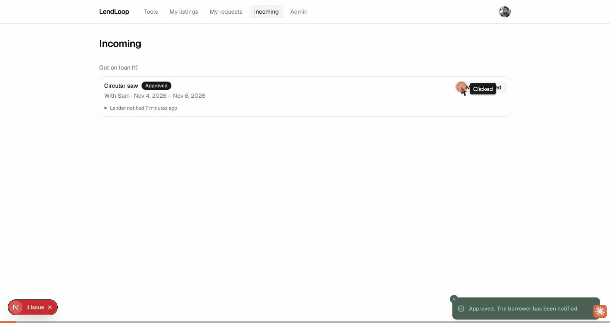
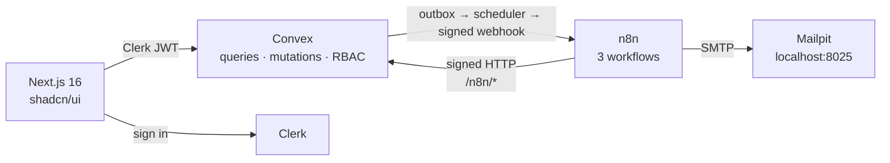

# LendLoop

**Borrow what you need. Lend what you don't.**

A neighborhood tool-lending board. Neighbors list tools, request to borrow
them for a date range, owners approve or decline, and loans get marked as
returned. n8n sends the notifications and a daily overdue reminder. If
automation fails, it shows up in an admin panel.



<sub>Recorded against the local stack: approve a request (the borrower is notified through n8n), an expected error shown as a toast, the Trusted Lender toggle, admin removal of a listing with a pending request, and the Automation health panel.</sub>

## Features

- **Public landing:** tagline plus a read-only grid of tools showing only name and category.
- **Tools catalog:**
  - Category filter kept in the URL.
  - Availability badges ("Available", "On loan until …", "Requested"), lender's first name and a Trusted Lender badge.
  - "Request to borrow" dialog with a range picker and inline validation.
- **My listings:** create, edit and delete your tools (soft delete; blocked while loans are open).
- **My requests / Incoming:** borrower and lender views.
  - Approve, decline, cancel and mark returned, each behind a confirmation.
  - Each loan card has an activity feed, e.g. "Lender notified 3 hours ago" or "Reminder sent".
- **Admin:** remove any listing, see every loan, toggle Trusted Lender, and an **Automation health** panel. Failed or retrying notifications, failed reminders and n8n workflow errors all show up there, so nothing fails silently.
- **n8n automation:**
  - Signed loan-event emails, deduplicated per event.
  - Daily 09:00 overdue reminders with an idempotent write-back to Convex.
  - An error workflow that alerts the admin and reports to Convex.

## How it fits together



- **Convex** is the single source of truth and the only place authorization
  happens.
- **Status changes and notifications:** every status change writes a
  notification to an outbox **in the same transaction** and schedules its
  delivery. Delivery is retried with backoff and surfaced to admins if it
  keeps failing.
- **Signing:** each direction has its own secret (HMAC-SHA256 over
  `timestamp.rawBody`, 300 s replay window, constant-time compare).

The full diagrams and the security notes are in
[docs/ARCHITECTURE.md](docs/ARCHITECTURE.md).

**Stack:** Next.js 16 (App Router, TypeScript strict) · Clerk · Convex · n8n 2.45 (Docker) · Tailwind 4 + shadcn/ui · Zod · Vitest + convex-test · pnpm

| Doc | What's in it |
|---|---|
| [docs/ARCHITECTURE.md](docs/ARCHITECTURE.md) | Component diagram, notification and reminder sequences, security and data minimization |
| [docs/DECISIONS.md](docs/DECISIONS.md) | ADR-style decisions, including every deviation from the brief |
| [docs/PRODUCTION.md](docs/PRODUCTION.md) | What I'd change before real users |
| [n8n/README.md](n8n/README.md) | Workflow internals, import/export, smoke tests |

## Prerequisites

- Node **22.13+** (`nvm use` reads `.nvmrc`) and pnpm 11 (`corepack enable`)
- Docker with Compose v2
- A free [Clerk](https://clerk.com) application:
  1. Create an application (email or Google sign-in is fine).
  2. **Configure → Integrations → Convex → Activate.** Copy the **Frontend API
     URL** (`https://<name>.clerk.accounts.dev`); that is `CLERK_JWT_ISSUER_DOMAIN`.
  3. **Configure → Sessions → Customize session token**, add the claims Convex
     reads for the user's name and email (without them, users are stored as
     "Neighbor" with no email and can't receive notifications):
     ```json
     { "name": "{{user.full_name}}", "email": "{{user.primary_email_address}}" }
     ```
  4. **API keys:** copy the publishable key and the secret key.

## Quickstart

```bash
pnpm install
cp .env.example .env.local        # then paste the two Clerk keys into .env.local
npx convex dev                    # choose a *local* deployment; keep it running (terminal 1)
pnpm setup:local https://<name>.clerk.accounts.dev   # n8n/.env with fresh secrets + Convex env vars
pnpm stack:up                     # n8n + Postgres + Mailpit; open http://localhost:5678 and create the n8n owner
pnpm n8n:credentials              # Mailpit SMTP credential (no secrets involved)
pnpm n8n:import                   # import + publish the 3 workflows
pnpm dev                          # http://localhost:3000, then sign in once (terminal 2)
npx convex run admin:setRole '{"email":"you@example.com"}'
pnpm seed '{"forEmail":"you@example.com"}'
```

Emails land in **Mailpit at <http://localhost:8025>**. Right after seeding you
should see two "New request" emails (one to the demo lender Maya, one to you).

`npx convex dev` writes `CONVEX_DEPLOYMENT`, `NEXT_PUBLIC_CONVEX_URL` and
`NEXT_PUBLIC_CONVEX_SITE_URL` into `.env.local`. The local backend serves the
client API on `:3210` and HTTP actions on `:3211`.

### Using a cloud Convex deployment instead

A cloud deployment can't reach `localhost:5678`. Expose n8n with a tunnel
(`cloudflared tunnel --url http://localhost:5678` or `ngrok http 5678`), then:

- `N8N_NOTIFY_WEBHOOK_URL=<tunnel>/webhook/lendloop-loan-events pnpm setup:local`
- In `n8n/.env`: `CONVEX_HTTP_URL=https://<deployment>.convex.site` and
  `N8N_WEBHOOK_URL=<tunnel>/`. Then run `pnpm stack:up` again.

## Trying each workflow

| Workflow | How to trigger it | What to look for |
|---|---|---|
| **Loan notifications** | Any status change in the app: request, approve, decline, cancel, mark returned. `pnpm seed` also queues one. | An email in Mailpit, "Lender notified …" on the loan card, and the outbox row `delivered`. |
| **Overdue reminders** | n8n editor → *LendLoop · Overdue reminders* → **Execute workflow**, or `pnpm n8n:remind`. The seed creates an overdue Pressure washer loan, plus a Tile saw loan for you with `forEmail`. | A "Reminder: please return …" email; "Reminder sent" on the loan card. Run it again: no second email (idempotent). |
| **Error handler** | `pnpm n8n:smoke unknown` sends a signed event with an unknown type, so the published webhook workflow fails. n8n doesn't call error workflows for manual editor runs. | An `[LendLoop] Workflow failed` email to `ADMIN_ALERT_EMAIL`, and the error under **Admin → Automation health**. |

To exercise the signature checks without the app, run `pnpm n8n:smoke`. It
sends a valid event (200), the same event again (200, duplicate: no second
email), a tampered body (401), a wrong secret (401) and a stale timestamp (401).

To see retries, run `docker compose --env-file n8n/.env stop mailpit` and then
approve something. The card shows "Notification failed – retrying", and
**Automation health** lists it with the next attempt time. Start Mailpit again
and it gets delivered.

## Environment variables

Every variable is documented in [`.env.example`](.env.example) and
[`n8n/.env.example`](n8n/.env.example). Nothing secret is committed.
`pnpm check-secrets` (also run in CI) verifies that.

| Variable | Where | Purpose |
|---|---|---|
| `NEXT_PUBLIC_CONVEX_URL` | `.env.local` (written by Convex CLI) | Convex client URL |
| `NEXT_PUBLIC_CLERK_PUBLISHABLE_KEY` | `.env.local` | Clerk publishable key |
| `CLERK_SECRET_KEY` | `.env.local` | Clerk secret key (server only) |
| `CLERK_JWT_ISSUER_DOMAIN` | Convex env | Clerk Frontend API URL; Convex validates JWTs against it |
| `N8N_NOTIFY_WEBHOOK_URL` | Convex env | n8n webhook that receives loan events |
| `CONVEX_TO_N8N_SECRET` | Convex env **and** `n8n/.env` | Convex signs events, n8n verifies |
| `N8N_TO_CONVEX_SECRET` | Convex env **and** `n8n/.env` | n8n signs calls to `/n8n/*`, Convex verifies |
| `APP_BASE_URL` | Convex env and `n8n/.env` | Links in emails |
| `N8N_ENCRYPTION_KEY` | `n8n/.env` | Encrypts n8n credentials at rest; keep it stable |
| `CONVEX_HTTP_URL` | `n8n/.env` | Where n8n reaches Convex (`http://host.docker.internal:3211` locally) |
| `ADMIN_ALERT_EMAIL` | `n8n/.env` | Recipient of error-workflow alerts |
| `GENERIC_TIMEZONE` | `n8n/.env` | Time zone of the 09:00 schedule |
| `POSTGRES_USER` / `POSTGRES_PASSWORD` / `POSTGRES_DB` | `n8n/.env` | n8n's own database |
| `N8N_BLOCK_ENV_ACCESS_IN_NODE=false` | `docker-compose.yml` | Lets Code nodes read the secrets via `$env` (n8n 2.x blocks it by default) |

Convex variables are set with `npx convex env set` (`pnpm setup:local` does it
for you). Convex functions can't read `.env.local`.

## Roles

- **User:** lists, edits and deletes their own tools; requests any active tool
  except their own; cancels their own pending requests; approves, declines and
  marks returned on loans of their own tools.
- **Admin:** all of the above, plus removing any listing (pending requests are
  declined and borrowers notified), viewing all loans, toggling **Trusted
  Lender**, and the **Automation health** panel.

Roles are stored in Convex and enforced in every function. There is no UI or
API path to become an admin. The first admin is created from the CLI with
`npx convex run admin:setRole '{"email":"..."}'`; the user must have signed in
once.

## Scripts

| Command | Does |
|---|---|
| `pnpm dev` / `pnpm build` | Next.js |
| `pnpm typecheck` · `pnpm lint` · `pnpm test` | Checks (also in CI) |
| `pnpm setup:local [issuer]` | Create `n8n/.env` with random secrets and push shared values to Convex |
| `pnpm stack:up` / `pnpm stack:down` | Start or stop n8n, Postgres and Mailpit |
| `pnpm n8n:credentials` | Create the Mailpit SMTP credential in n8n |
| `pnpm n8n:import` / `pnpm n8n:export` | Import and publish workflows / export, clean and secret-scan them |
| `pnpm n8n:smoke [unknown]` | Signed test events against the webhook |
| `pnpm n8n:remind` | Run the overdue reminders now |
| `pnpm seed ['{"forEmail":"..."}']` | Demo neighborhood with an overdue loan |
| `pnpm check-secrets` | Scan the repo for secrets |

## Tests

`pnpm test` runs 63 Vitest + convex-test cases against an in-memory Convex. They
cover:

- **RBAC:** editing or deleting another user's tool, approving a loan on someone
  else's tool, borrowing your own tool, setting your own role, and an admin
  removing any listing.
- **Loan state machine:** valid and invalid transitions, and overlapping
  approvals.
- **Public projection:** `listPublic` returns exactly `_id`, `name` and
  `category`.
- **HMAC:** a known vector, tampering, wrong secret, stale timestamp and swapped
  timestamp.
- **Signed HTTP endpoints:** 401, 503 and replay handling, and idempotent
  reminder write-back (one row for the same key).
- **Outbox:** atomic with the status change, no row when the change is rejected,
  retries and backoff, and payload minimization.
- **Activity feed, health panel and seed.**

## Project structure

```
lendloop/
├─ src/
│  ├─ app/                    # Next.js routes: landing + (app)/{tools,listings,requests,incoming,admin}
│  ├─ components/             # feature components (tools, loans, admin, app-shell) + shadcn/ui
│  ├─ lib/                    # client helpers: error mapping, labels, date formatting
│  └─ proxy.ts                # clerkMiddleware (Next 16 renamed middleware → proxy)
├─ convex/
│  ├─ schema.ts               # users, tools, loans, notificationOutbox, reminders, automationEvents
│  ├─ lib/                    # auth helpers, loan state machine, HMAC, outbox, validation, dates
│  ├─ users.ts tools.ts loans.ts admin.ts
│  ├─ notifications.ts        # outbox delivery to n8n, retries, stuck-event sweeper
│  ├─ automation.ts http.ts   # signed endpoints called by n8n + idempotent write-backs
│  ├─ crons.ts seed.ts
│  └─ *.test.ts               # convex-test suites (not deployed)
├─ n8n/
│  ├─ workflows/              # exported JSON: request-notification, overdue-reminders, error-handler
│  └─ README.md               # workflow internals, import/export, smoke tests
├─ scripts/                   # setup-local, n8n import/export/credentials, check-secrets, smoke test
├─ docs/                      # ARCHITECTURE, DECISIONS, PRODUCTION
├─ docker-compose.yml         # n8n 2.45.7 + Postgres 17 + Mailpit
└─ .github/workflows/ci.yml   # typecheck · lint · test · secret scan
```

## Troubleshooting

These are the problems that came up while building and testing this.

| Symptom | Cause | Fix |
|---|---|---|
| `ERR_UNKNOWN_BUILTIN_MODULE: node:sqlite` or "pnpm requires Node 22.13" | pnpm 11 needs Node 22 | `nvm install 22 && nvm alias default 22`, then open a new terminal |
| Clerk says you're signed in, but the page still shows "Sign in", plus a `cannot_render_single_session_enabled` notice | Convex is rejecting the Clerk token | Activate **Integrations → Convex** in Clerk. Then make Convex re-read `auth.config.ts` (it only does on push): restart `npx convex dev`, or touch `convex/auth.config.ts` |
| Your user shows up as "Neighbor" with no email; `admin:setRole` says "No user with email" | The Clerk session token has no `name`/`email` claims | Add them under **Sessions → Customize session token** (see Prerequisites) and reload |
| Webhook returns 404 "not registered" | Workflows weren't published, or n8n wasn't restarted | `pnpm n8n:import` (it publishes and restarts) |
| Error workflow never runs ("is not active and cannot be executed" in the n8n logs) | n8n 2.x only calls *published* error workflows, and never for manual editor runs | `pnpm n8n:import` publishes it. Trigger it with `pnpm n8n:smoke unknown` |
| `n8n execute` says "Task Broker's port 5679 is already in use" | The running n8n holds the default broker port | Use `pnpm n8n:remind`, which sets `N8N_RUNNERS_BROKER_PORT` |
| Next.js dev overlay shows a hydration mismatch with `data-gr-*` attributes | A browser extension (Grammarly) edits `<body>` before React hydrates | Harmless; `<body>` has `suppressHydrationWarning` |

