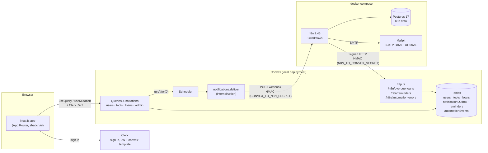
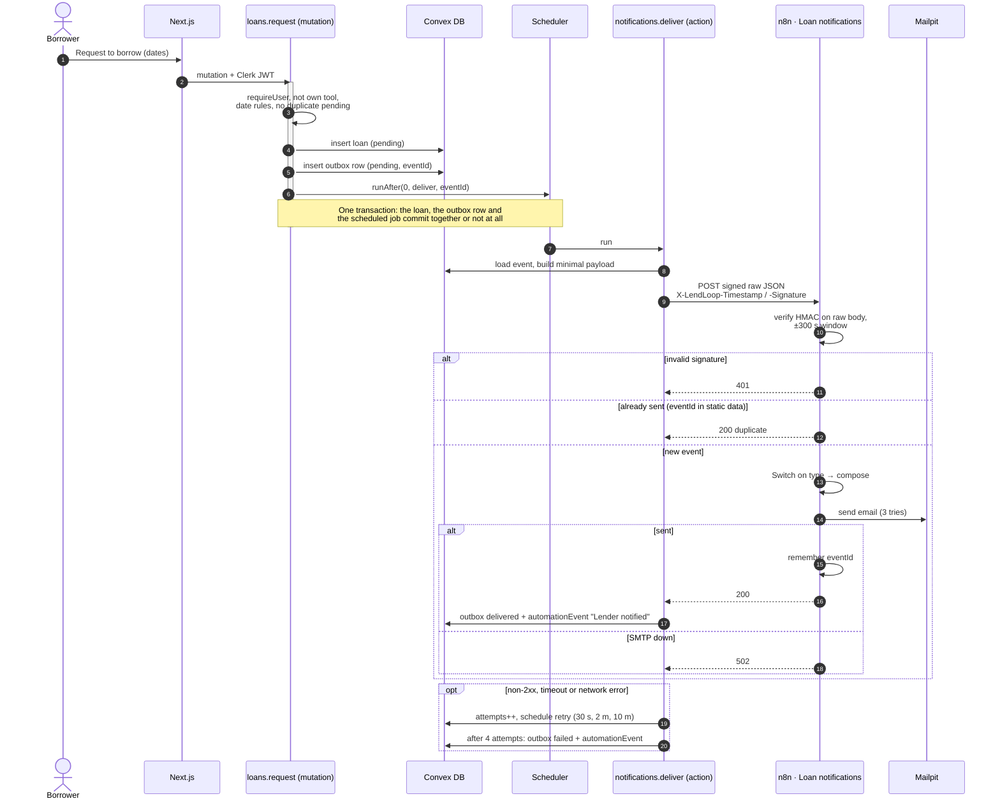

# Architecture

LendLoop has four moving parts. Next.js renders the UI. Clerk signs people in.
Convex holds all data and all business logic. n8n sends emails and runs the
daily overdue check. Convex is the only source of truth: n8n never touches the
database, it only calls three signed HTTP endpoints.

## 1. Components



| Concern | Where it lives |
|---|---|
| Authentication | Clerk. Convex validates the JWT (`convex/auth.config.ts`). |
| Authorization | `convex/lib/auth.ts`, called at the top of every public function |
| Business rules | `convex/lib/loanStateMachine.ts`, `loanRules.ts`, `toolInput.ts` |
| Outbound events | `notificationOutbox` + `notifications.deliver` |
| Inbound automation | `convex/http.ts` → internal mutations in `automation.ts` |
| Delivery and scheduling | n8n workflows in `n8n/workflows/` |

## 2. Request notification (transactional outbox)



## 3. Overdue reminders (idempotent write-back and error path)

```mermaid
sequenceDiagram
  autonumber
  participant T as Schedule 09:00 / manual
  participant N as n8n · Overdue reminders
  participant H as Convex http.ts
  participant DB as Convex DB
  participant SMTP as Mailpit
  participant E as n8n · Error handler

  T->>N: start
  N->>H: GET /n8n/overdue-loans (signed, empty body)
  H->>H: verify HMAC (N8N_TO_CONVEX_SECRET)
  H->>DB: approved loans with endDate < today<br/>minus those with a "sent" reminder for today's key
  H-->>N: [{ loanId, reminderKey, borrower{firstName,email}, tool{name}, endDate, daysOverdue }]
  loop each loan (Split In Batches)
    N->>SMTP: reminder email (3 tries, continue on fail)
    N->>H: POST /n8n/reminders { idempotencyKey, loanId, status: sent|failed, executionId } (signed)
    H->>DB: lookup by idempotencyKey
    alt absent
      DB-->>H: insert reminder + automationEvent
      H-->>N: 200 { duplicate: false }
    else already sent
      H-->>N: 200 { duplicate: true }
    end
  end
  Note over N,DB: Rerunning the workflow the same day sends nothing:<br/>the fetch excludes loans that already have a sent reminder

  rect rgba(200, 0, 0, 0.06)
    Note over N,E: Error path: Convex unreachable after 3 retries,<br/>or any unhandled node error
    N--)E: execution failed (settings.errorWorkflow)
    E->>E: summarize (execution id, workflow, node, message; no item data)
    E->>SMTP: alert ADMIN_ALERT_EMAIL
    E->>H: POST /n8n/automation-errors (signed)
    H->>DB: automationEvent workflow_error (deduped per execution)
    Note over DB: Visible in Admin → Automation health
  end
```

## 4. Security and data minimization

**Authorization lives in the backend.** Every public query and mutation begins
with `requireUser`, `requireAdmin`, `requireToolOwner` or `requireLoanParty`.
The UI hides buttons for convenience only. Lenders approve, decline and mark
returned; borrowers cancel; owners edit their own tools; nobody borrows their
own tool. Tests call the functions directly as other users to prove this
(`convex/*.test.ts`).

**The role is server-side.** `role` and `trustedLender` live in the Convex
`users` table. `users.store` takes no arguments and builds the row from the
verified JWT identity, so a client can't send a role. The first admin is created
with the `admin:setRole` internal mutation from a trusted shell; there is no
API or UI path to escalate.

**Internal by default.** Everything only n8n or the scheduler should reach
(`deliver`, `markDelivered`, `recordFailure`, `overdueLoans`, `recordReminder`,
`recordWorkflowError`, `setRole`, `seed:run`) is an `internal*` function. The
HTTP endpoints are the only way in from n8n, and each one requires a signature.

**HMAC with a timestamp, in both directions, with separate secrets.**
`X-LendLoop-Signature: sha256=HMAC_SHA256(secret, "${timestamp}.${rawBody}")`.

- The timestamp is part of the signed message and must be within 300 s, which
  blocks replays.
- Comparison is constant time (`timingSafeEqual` in Convex,
  `crypto.timingSafeEqual` in n8n).
- Verification runs on the **raw** body: the n8n Webhook node has Raw Body
  enabled, and Convex reads `request.text()` before parsing.
- `CONVEX_TO_N8N_SECRET` and `N8N_TO_CONVEX_SECRET` are different. Leaking one
  doesn't let an attacker forge the other direction.
- Failures return a generic 401; the reason is only logged.
- Bodies over 16 KB are rejected, and parsed bodies are validated with Zod.

**No secrets in the repo.**

- Workflow JSON contains only `{{ $env.X }}` expressions and credential
  references by id.
- SMTP settings live in an n8n credential.
- Every `.env*` except the examples is git-ignored.
- `scripts/check-secrets.sh` runs in CI and on export. It scans for known key
  formats, secret-looking assignments, the literal values of local env files,
  and credential, pinned or static data in workflow exports.

**Minimal payloads.**

- Convex → n8n: `{ eventId, type, occurredAt, recipient{firstName,email},
  tool{name}, loan{id,startDate,endDate,status} }`. No description, no
  counterpart's details, no user ids.
- Overdue feed: only what the reminder needs.
- Error reports: execution metadata only, never item data.

**Public projection.** `tools.listPublic` returns exactly
`{ _id, name, category }` through an explicit map (a test asserts the keys).
Signed-in lists show the owner's first name and Trusted Lender badge. The only
email that ever reaches a browser is the user's own, via `users.me`.

**No PII in logs.** Convex logs event ids, types and error classes. The n8n
mock-notification and error nodes log ids and types, never addresses or names.

**Soft deletes.** Tools are deactivated (`isActive: false`, `removedBy`), never
hard-deleted, so loan history stays intact. Owners can't delete a tool with
open loans. Admin removal declines pending requests through the state machine,
so borrowers are notified.

**Validation.** Convex validators check types at the API boundary. Shared Zod
schemas and date rules check business limits, and the same code produces the
inline form errors in the UI.
